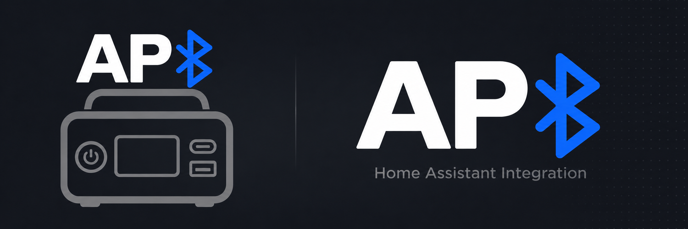

# ALLPOWERS BLE para Home Assistant

[](https://www.home-assistant.io/)
[](https://www.hacs.xyz/)
[](https://github.com/dedalodaelus/home-assistant-allpowers-ble/actions/workflows/ci.yml)
[](https://github.com/dedalodaelus/home-assistant-allpowers-ble/blob/devel/LICENSE)

[English](https://github.com/dedalodaelus/home-assistant-allpowers-ble/blob/devel/README.md)

<p align="center"></p>

Conecta estaciones ALLPOWERS compatibles con Home Assistant mediante Bluetooth
local, usando un adaptador local o un ESPHome Bluetooth Proxy con conexiones
**activas**. Home Assistant selecciona y actualiza la ruta BLE al reconectar.
No requiere nube del fabricante ni un componente ESPHome en la estación.

## Funciones

- Descubrimiento automático y configuración desde la interfaz; admite varias
  estaciones.
- Entidades de batería, potencia, tiempo restante, salidas, ajustes, versiones,
  señal y estado.
- Polling local de estado con notificaciones push, reconexión y recuperación de ruta.
- Controles condicionados por datos recientes que conservan estados de salida
  documentados y bits de ajustes no relacionados.
- Diagnósticos redactados y Repairs para problemas persistentes que requieren acción.

## Compatibilidad

| Modelo/perfil | Estado |
|---|---|
| R600 y VOLIX P1800 canónicos con revisión `0.3` (`0x03`) | Perfiles reconocidos por código; cualificación HIL física pendiente |
| Identidades amplias o desconocidas, incluidos candidatos `AP S*` | Experimental, solo lectura tras prueba activa del protocolo |
| AP S500 / AP S700 V2 | Rechazados: revisión de protocolo diferente |

El reconocimiento del perfil de código no equivale a cualificación física. Los
candidatos desconocidos siguen en solo lectura y los modelos rechazados continúan
rechazados. Consulta la [matriz
completa](https://github.com/dedalodaelus/home-assistant-allpowers-ble/blob/devel/docs/compatibility.md).

## Requisitos e instalación

- Home Assistant **2026.10.4 o posterior**. Coincide con la versión fijada
  para las pruebas de compatibilidad de la integración con Home Assistant real.
- Un adaptador Bluetooth local conectable o un ESPHome Bluetooth Proxy **activo**.
  Un proxy pasivo no mantiene la conexión GATT necesaria.
- Estación encendida y dentro de un alcance BLE fiable.

Instalación recomendada con HACS:

1. Abre **HACS → Integraciones → ⋮ → Repositorios personalizados**.
2. Añade `https://github.com/dedalodaelus/home-assistant-allpowers-ble` con la
   categoría **Integración**.
3. Instala **ALLPOWERS BLE** y reinicia Home Assistant.
4. Abre **Ajustes → Dispositivos y servicios** y acepta el descubrimiento, o
   selecciona **Añadir integración → ALLPOWERS BLE**.

Para la instalación manual, copia únicamente este directorio en la configuración
de Home Assistant y reinicia:

```text
custom_components/allpowers_ble/
```

Home Assistant elige una ruta Bluetooth disponible. Tras una desconexión, la
integración vuelve a resolver la ruta y puede reconectar mediante otro adaptador
o proxy activo disponible.

## Seguridad y limitaciones

> **Aviso:** No uses esta integración como enclavamiento de seguridad para cargas
> críticas desatendidas. Una llamada de servicio completada significa que el
> comando se envió por BLE, no que el dispositivo lo haya confirmado físicamente.
> Las entidades solo cambian mediante telemetría, que puede quedar obsoleta o no
> estar disponible.

Las escrituras requieren instantáneas recientes de la misma sesión y capacidades
verificadas. Los perfiles experimentales son de solo lectura. Una notificación
coincidente muestra convergencia observada, pero no demuestra causalidad: el
protocolo no tiene ID de transacción. La cualificación HIL física sigue pendiente
para los perfiles reconocidos. Revisa el [modelo de seguridad
completo](https://github.com/dedalodaelus/home-assistant-allpowers-ble/blob/devel/docs/user-guide.es.md#seguridad-de-las-escrituras)
antes de activar controles o automatizaciones.

## Documentación y soporte

- [Guía de usuario
  completa](https://github.com/dedalodaelus/home-assistant-allpowers-ble/blob/devel/docs/user-guide.es.md)
  · [User guide in
  English](https://github.com/dedalodaelus/home-assistant-allpowers-ble/blob/devel/docs/user-guide.md)
- [Compatibilidad](https://github.com/dedalodaelus/home-assistant-allpowers-ble/blob/devel/docs/compatibility.md)
  · [Resolución de
  problemas](https://github.com/dedalodaelus/home-assistant-allpowers-ble/blob/devel/docs/troubleshooting.md)
- [Arquitectura](https://github.com/dedalodaelus/home-assistant-allpowers-ble/blob/devel/docs/architecture/README.md)
  ·
  [Protocolo](https://github.com/dedalodaelus/home-assistant-allpowers-ble/blob/devel/docs/protocol.md)
  ·
  [Desarrollo](https://github.com/dedalodaelus/home-assistant-allpowers-ble/blob/devel/docs/development.md)
- [Reportar un fallo o
  compatibilidad](https://github.com/dedalodaelus/home-assistant-allpowers-ble/issues/new/choose)
  · [Reportar una
  vulnerabilidad](https://github.com/dedalodaelus/home-assistant-allpowers-ble/security/advisories/new)
- Integración personalizada comunitaria, no forma parte de Home Assistant Core ni
  recibe su soporte. [Licencia
  MIT](https://github.com/dedalodaelus/home-assistant-allpowers-ble/blob/devel/LICENSE).
