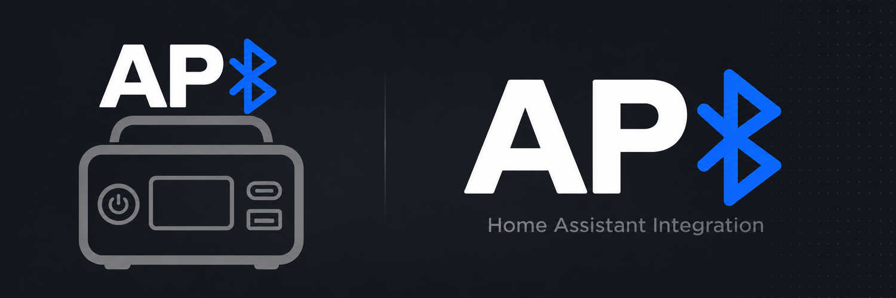

# ALLPOWERS BLE for Home Assistant

[](https://www.home-assistant.io/)
[](https://www.hacs.xyz/)
[](https://github.com/dedalodaelus/home-assistant-allpowers-ble/actions/workflows/ci.yml)
[](https://github.com/dedalodaelus/home-assistant-allpowers-ble/blob/main/LICENSE)

[Español](https://github.com/dedalodaelus/home-assistant-allpowers-ble/blob/main/README.es.md)

<p align="center"></p>

Connect compatible ALLPOWERS power stations to Home Assistant over local
Bluetooth, using a local adapter or an **active** ESPHome Bluetooth Proxy.
Home Assistant selects and refreshes the BLE route when a reconnect is needed.
No vendor cloud or device-side ESPHome component is required.

## Features

- Automatic discovery and UI-based setup; supports multiple stations.
- Battery, power, remaining-time, output, settings, version, signal, and health
  entities.
- Local status polling with push notifications, reconnection, and route recovery.
- Freshness-gated controls that preserve documented output states and unrelated
  settings bits.
- Redacted diagnostics and Home Assistant Repairs for persistent actionable problems.

## Compatibility

| Model/profile | Status |
|---|---|
| Canonical R600 and VOLIX P1800 with hardware revision `0.3` (`0x03`) | Recognized code profiles; physical HIL qualification pending |
| Broad or unknown identities, including `AP S*` candidates | Experimental, read-only after active protocol probe |
| AP S500 / AP S700 V2 | Rejected: different protocol revision |

Code-profile recognition does not mean hardware qualification. Unknown candidates
stay read-only; rejected models remain rejected. See the [full compatibility matrix](https://github.com/dedalodaelus/home-assistant-allpowers-ble/blob/main/docs/compatibility.md).

## Requirements & installation

- Project support minimum: Home Assistant **2026.10.4**. This matches the
  pinned release used by the real-Core compatibility tests; earlier releases
  are outside the declared support policy, not asserted to be technically
  incompatible.
- A connectable local Bluetooth adapter or an **active** ESPHome Bluetooth Proxy.
  Passive-only proxies cannot maintain the required GATT connection.
- Device powered on and within reliable BLE range.

Recommended HACS installation:

1. Open **HACS → Integrations → ⋮ → Custom repositories**.
2. Add `https://github.com/dedalodaelus/home-assistant-allpowers-ble` as an
   **Integration** repository.
3. Install **ALLPOWERS BLE**, then restart Home Assistant.
4. Open **Settings → Devices & services** and accept discovery, or select
   **Add integration → ALLPOWERS BLE**.

For manual installation, copy only this directory into the Home Assistant
configuration directory, then restart:

```text
custom_components/allpowers_ble/
```

Home Assistant selects an available Bluetooth route. After a disconnect, the
integration resolves the route again and can reconnect through another available
adapter or active proxy.

## Safety & limitations

> **Warning:** Do not use this integration as a hard safety interlock for
> unattended critical loads. A successful service call means the command was
> submitted over BLE, not physically confirmed. Entity state changes only from
> device telemetry, and telemetry can become stale or unavailable.

Writes require fresh same-session snapshots and verified capabilities.
Experimental profiles are read-only. A matching notification shows observed
convergence but cannot prove command causality; the protocol has no transaction
ID. Physical HIL qualification remains pending for the recognized profiles. Review
the [full safety model](https://github.com/dedalodaelus/home-assistant-allpowers-ble/blob/main/docs/user-guide.md#safety-model)
before enabling controls or automations.

## Documentation & support

- [Full user guide](https://github.com/dedalodaelus/home-assistant-allpowers-ble/blob/main/docs/user-guide.md)
  · [Guía de usuario en español](https://github.com/dedalodaelus/home-assistant-allpowers-ble/blob/main/docs/user-guide.es.md)
- [Compatibility](https://github.com/dedalodaelus/home-assistant-allpowers-ble/blob/main/docs/compatibility.md)
  ·
  [Troubleshooting](https://github.com/dedalodaelus/home-assistant-allpowers-ble/blob/main/docs/troubleshooting.md)
- [Architecture](https://github.com/dedalodaelus/home-assistant-allpowers-ble/blob/main/docs/architecture/README.md)
  ·
  [Protocol](https://github.com/dedalodaelus/home-assistant-allpowers-ble/blob/main/docs/protocol.md)
  ·
  [Development](https://github.com/dedalodaelus/home-assistant-allpowers-ble/blob/main/docs/development.md)
- [Report a bug or compatibility issue](https://github.com/dedalodaelus/home-assistant-allpowers-ble/issues/new/choose)
  · [Report a vulnerability](https://github.com/dedalodaelus/home-assistant-allpowers-ble/security/advisories/new)
- Community-maintained custom integration; not part of or supported by Home
  Assistant Core. [MIT License](https://github.com/dedalodaelus/home-assistant-allpowers-ble/blob/main/LICENSE).
